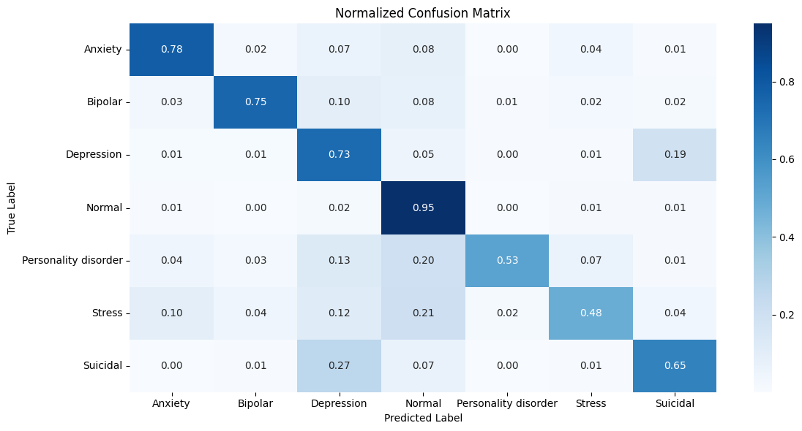
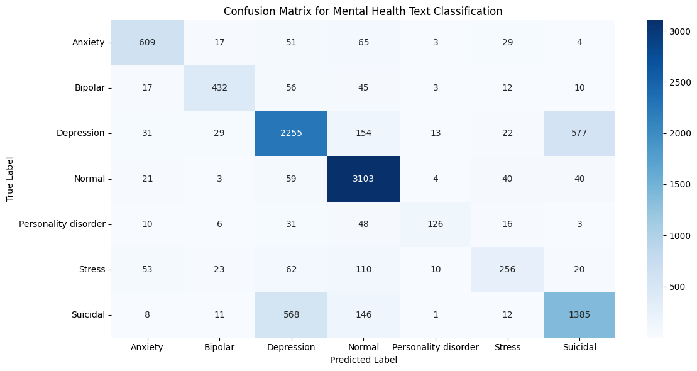
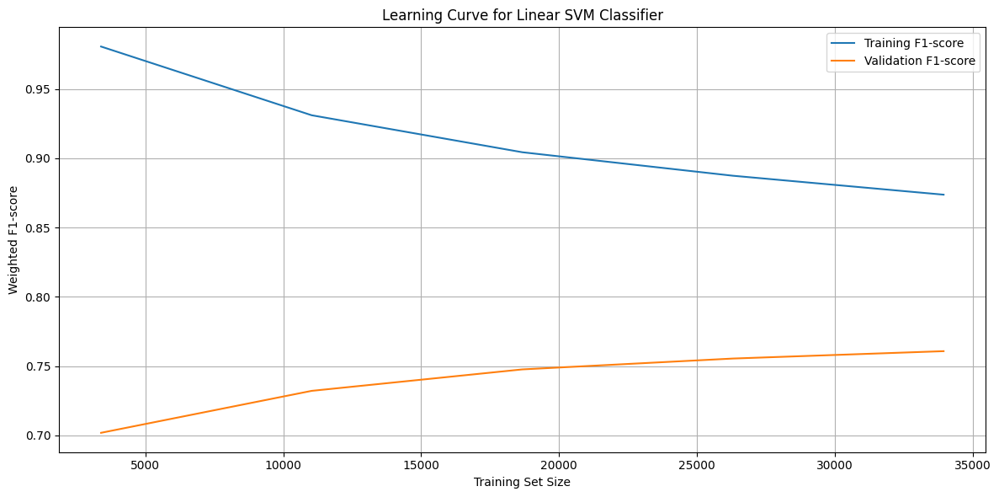
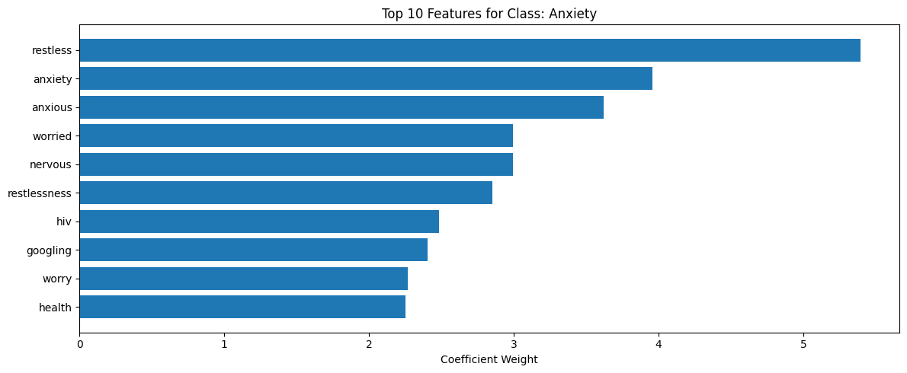
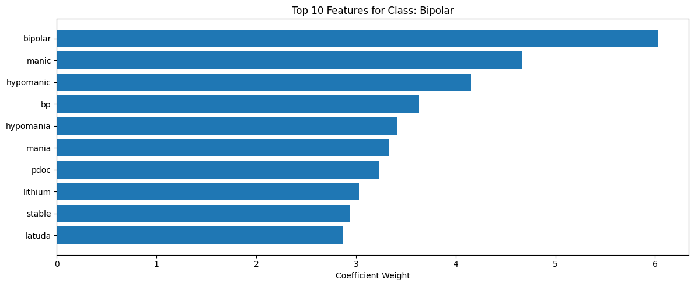
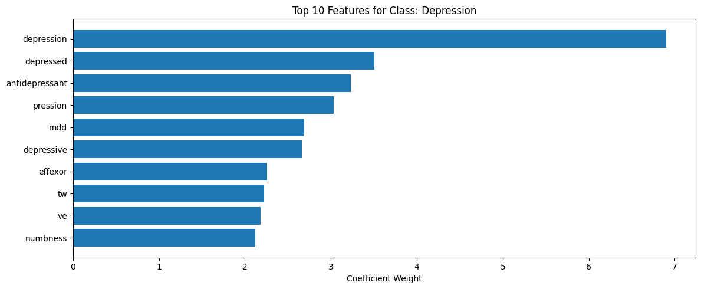
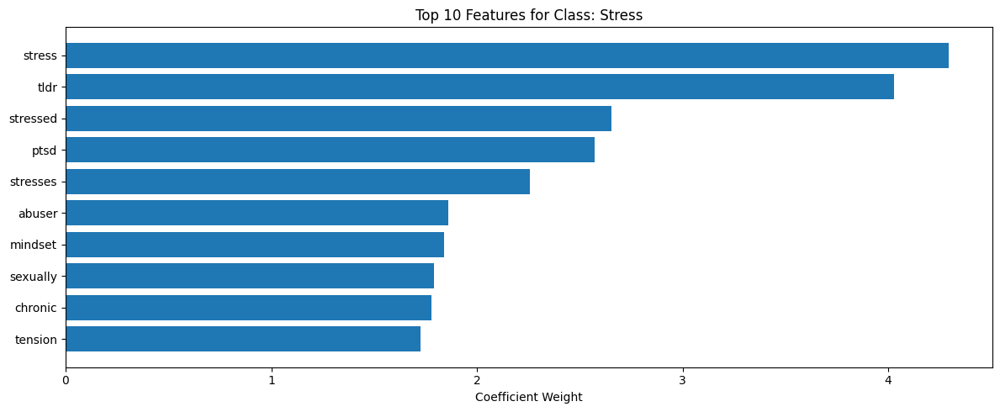
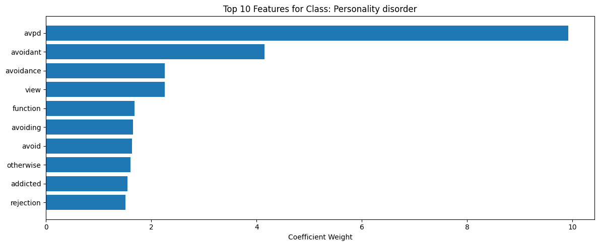
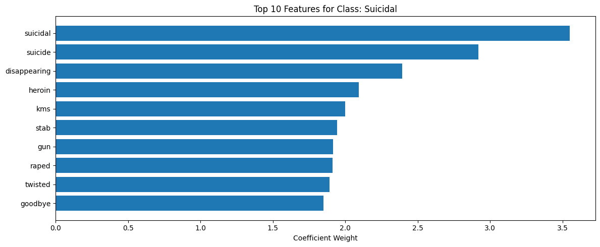
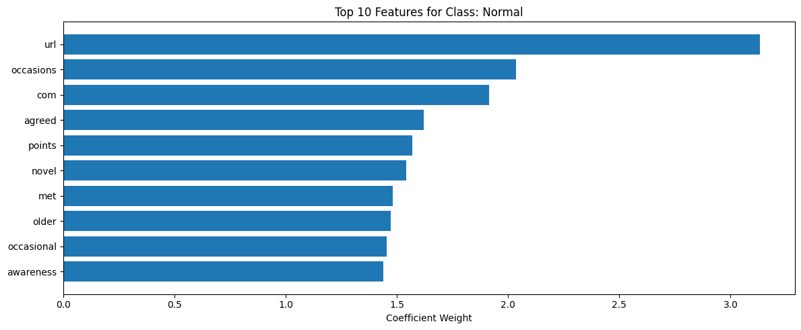

# Short-Text NLP for Mental Health Classification

A Python NLP project that classifies short, user-written statements into **seven mental health categories** using **TF-IDF features and a Linear Support Vector Machine**. It also includes a partial replication of a published study on anxiety and depression classification from psychotherapy transcripts.

> MSc Big Data Analytics, Programming for Data Science (Python), Victoria University Kampala



> **Disclaimer:** this is an academic project. It is not a diagnostic tool and must not be used to make clinical decisions. If you or someone you know is struggling, please contact a qualified professional or local emergency services.

## Table of Contents
- [Project Overview](#project-overview)
- [Part 1: Paper Review and Replication](#part-1-paper-review-and-replication)
- [Part 2: Dataset](#part-2-dataset)
- [Part 3: Proposed Model](#part-3-proposed-model)
- [Results](#results)
- [Interpretability](#interpretability)
- [Linear vs RBF SVM](#linear-vs-rbf-svm)
- [Limitations and Future Work](#limitations-and-future-work)
- [Getting Started](#getting-started)
- [Reproducibility](#reproducibility)
- [References](#references)

## Project Overview

| Part | Focus |
| --- | --- |
| 1 | Summarise, replicate and critique Sun et al. (2024) |
| 2 | Choose and describe a new dataset |
| 3 | Design, implement and evaluate an original classification pipeline |

**Hypotheses**
- **H₀:** traditional machine learning models do not perform competitively on short-text mental health classification.
- **H₁:** traditional models with suitable feature engineering reach competitive performance on short text while staying interpretable and computationally efficient.

## Part 1: Paper Review and Replication

**Paper:** Sun et al. (2024), *Evaluating Large Language Models for Anxiety and Depression Classification Using Counseling and Psychotherapy Transcripts*.

**Summary of the paper**
- **Goal:** compare traditional ML, deep learning and LLMs for classifying anxiety and depression in long psychotherapy transcripts
- **Data:** 3,503 anonymised sessions from the Alexander Street Press counselling and psychotherapy transcripts collection (80/20 split)
- **Methods (Python):** RBF-SVM on bag-of-words plus psychological features (over 30,000 features); fine-tuned BERT, RoBERTa, Longformer and Mistral-7B using PyTorch and HuggingFace; GPT prompting
- **Findings:** feature-engineered traditional ML performed on par with or better than deep learning and LLMs; GPT models were less accurate and unstable

**Replication (RBF-SVM baseline only)**

The authors released preprocessed features, so the baseline was reproduced from those: 2,804 training and 702 test samples with 32,925 features each. Features were z-score normalised using training statistics only, and an RBF-kernel SVM was wrapped in `MultiOutputClassifier` (about 58 minutes to train on CPU). The transformer and GPT experiments were not replicated because of GPU needs and proprietary, non-deterministic APIs.

| Model | Source | Accuracy | Weighted F1 | Weighted AUROC |
| --- | --- | --- | --- | --- |
| RBF SVM | Sun et al. (2024) | 0.549 | 0.485 | 0.705 |
| RBF SVM | This replication | 0.249 | 0.260 | 0.547 |

| Label | Precision | Recall | F1 | Support |
| --- | --- | --- | --- | --- |
| Anxiety | 0.618 | 0.499 | 0.552 | 347 |
| Depression | 1.000 | 0.007 | 0.015 | 271 |
| Other | 0.000 | 0.000 | 0.000 | 135 |

The replication scored well below the published numbers. It reproduced the same pattern (moderate anxiety detection, near-zero depression recall), but differences in scaling, hyperparameters and class weighting probably explain the gap.

**Gaps and proposed enhancements:** the study uses a single dataset, a limited label set and text only. Suggested improvements include more mental health labels, segment-level modelling within sessions, and human-in-the-loop verification.

## Part 2: Dataset

**Sentiment Analysis for Mental Health** ([Kaggle](https://www.kaggle.com/datasets/iamtodor/sentiment-analysis-for-mental-health)): roughly 50,000 short, user-generated text statements.

| Column | Type | Description |
| --- | --- | --- |
| `statement` | Text | Raw statement |
| `status` | Categorical | Mental health label |

**Classes (7):** Anxiety, Bipolar, Depression, Normal, Personality disorder, Stress, Suicidal

Unlike the long transcripts in Part 1, this data is short and informal, which lets the project test whether simpler text reduces the difficulties seen in prior work.

## Part 3: Proposed Model

**Algorithm:** TF-IDF-based mental health classification using a Linear SVM.

**Pipeline**
1. Load the data and check its structure
2. Clean text with a custom `clean_text()` function (lowercase, strip punctuation and non-alphabetic characters, normalise whitespace, handle missing values)
3. Encode labels with `LabelEncoder`
4. Stratified **80/20** train-test split with a fixed random seed
5. **TF-IDF** vectorisation, capped at **5,000 features** and fitted on training data only to avoid leakage
6. Train `LinearSVC` wrapped in `MultiOutputClassifier`
7. Predict on the test set and evaluate

**Libraries:** Pandas, NumPy, scikit-learn, Matplotlib, Seaborn

**Design decision:** an RBF-kernel SVM was tried first to match prior work, but it took close to an hour on CPU. Switching to a Linear SVM cut training time to seconds with comparable performance.

## Results

Evaluated on a held-out test set of 10,609 statements.

| Class | Precision | Recall | F1 | Support |
| --- | --- | --- | --- | --- |
| Anxiety | 0.81 | 0.78 | 0.80 | 778 |
| Bipolar | 0.83 | 0.75 | 0.79 | 575 |
| Depression | 0.73 | 0.73 | 0.73 | 3,081 |
| Normal | 0.85 | 0.95 | 0.89 | 3,270 |
| Personality disorder | 0.79 | 0.53 | 0.63 | 240 |
| Stress | 0.66 | 0.48 | 0.56 | 534 |
| Suicidal | 0.68 | 0.65 | 0.66 | 2,131 |

| Metric | Value |
| --- | --- |
| Accuracy | **0.77** |
| Macro F1 | 0.72 |
| Weighted F1 | 0.76 |

The model does best on well-represented classes (Normal, Anxiety, Bipolar). Recall is lowest for the small classes (Personality disorder, Stress). The biggest confusion is between **Depression and Suicidal**, which have overlapping language.

### Confusion matrix


### Normalized confusion matrix


### Learning curve
Validation F1 rises steadily as the training set grows, while training F1 falls. The gap narrows but does not close, so extra data or stronger regularisation could still help.



## Interpretability

A key advantage of a linear model is that the learned coefficients show which words drive each prediction. The top 10 TF-IDF features per class are semantically meaningful, for example *restless* and *anxious* for Anxiety, *manic* and *lithium* for Bipolar, and *avpd* and *avoidant* for Personality disorder.

<table>
  <tr>
    <td></td>
    <td></td>
  </tr>
  <tr>
    <td></td>
    <td></td>
  </tr>
  <tr>
    <td></td>
    <td></td>
  </tr>
  <tr>
    <td></td>
    <td></td>
  </tr>
</table>

The top features for the Normal class (such as `url` and `com`) look like dataset artefacts rather than meaningful signals, which is worth keeping in mind when interpreting results.

## Linear vs RBF SVM

| Criterion | Linear SVM (proposed) | RBF-kernel SVM |
| --- | --- | --- |
| Predictive performance | Comparable | Similar or marginally higher |
| Training time | Seconds | Close to an hour on CPU |
| Memory use | Low | High |
| Scalability | High | Limited |
| Hyperparameter sensitivity | Low | High (γ, C) |
| Interpretability | High (feature weights) | Low |
| Deployment suitability | Excellent | Poor |

## Limitations and Future Work

**Limitations**
- TF-IDF ignores word order and context
- A linear boundary may miss complex semantic patterns
- Class imbalance reduces recall on minority classes
- Labels may be subjective, and the data comes from a single source
- Heavy overlap between Depression and Suicidal statements

**Future work**
- Add n-gram features
- Try dimensionality reduction (truncated SVD)
- Test class weighting or resampling
- Try ensemble approaches
- Benchmark against contextual embeddings such as BERT

## Getting Started

```bash
# 1. Clone the repository
git clone https://github.com/YOUR-USERNAME/short-text-nlp-mental-health.git
cd short-text-nlp-mental-health

# 2. Install dependencies
pip install pandas numpy scikit-learn matplotlib seaborn jupyter

# 3. Download the dataset from Kaggle and place the CSV in the project folder
#    https://www.kaggle.com/datasets/iamtodor/sentiment-analysis-for-mental-health

# 4. Open the notebook
jupyter notebook
```

## Reproducibility

Every stage (loading, preprocessing, feature extraction, training, evaluation and plotting) is implemented in the Jupyter Notebook. Random seeds are fixed for splitting and model initialisation, and hyperparameters and dependencies are stated explicitly.

## References

- Kaggle. (2023). *Sentiment analysis for mental health* [Dataset]. https://www.kaggle.com/datasets/iamtodor/sentiment-analysis-for-mental-health
- Sun, J., Ma, S., Fan, Y., & Washington, P. (2024). Evaluating large language models for anxiety and depression classification using counseling and psychotherapy transcripts.

## Author

**Registration No:** VU-MBD-2511-0359-WEE · Victoria University Kampala, Uganda
